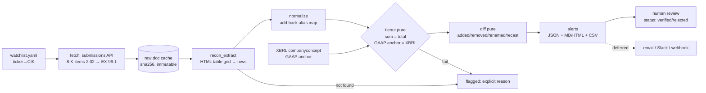

# Footnote Pivot: Disclosure-Change Monitor

**Status:** Proposed, 2026-10-04. **Baseline commit:** `ffb3bcf` (HEAD, verified 2026-10-04).
**Evidence labels:** **V** = VERIFIED (path cited) · **A** = ASSUMED · **U** = UNKNOWN.

> **GATE G1: THE THIN SLICE IS CONDITIONAL.**
> The thin slice (Phase P2) proceeds only if **≥3 of 10 interviewees ask for a trial or name a budget**.
> **No slice code is written before G1 passes.** Until then the only permitted work is P0 (1 day) and P1 (interviews with hand-made alerts).

> **PRE-COMMITTED KILL CRITERIA (from the audit plan §8, verbatim; any one triggers)**
> - G1 fails: fewer than 3 of 10 interviewees ask for a trial or name a budget.
> - ≥6 of 10 interviewees say an existing tool already covers this.
> - Tie-out pass rate <70% after 2 weeks.
> - Alert precision <50%.
> - Zero real changes across 15 tickers × 8 quarters. The signal is too rare at this scope; consider pivoting to cross-company comparison.
>
> **Whole-effort kill (week ~10).** No design partner reading alerts weekly for 4 weeks, or no verbal price commitment → stop.

> **DEFINITION OF DONE (applies to every feature, doc and status table)**
> A feature is *done* only when it **runs on a real saved SEC filing** and **a human has checked the output** against the source.
> Mocked, synthetic or fixture-only tests do not count. No document (README, DECISIONS, plan, tracker) may mark a feature shipped, done or complete otherwise.

---

## 1. Summary and intent

| | |
|---|---|
| **What changes** | Footnote stops being "upload a PDF, get a workbook." It becomes a local CLI that watches 10–20 tickers' 8-K Item 2.02 earnings releases (EX-99.1). It extracts the headline non-GAAP reconciliation, ties it out, and diffs it against prior quarters. Alerts cover added/removed add-backs, renamed metrics and recast prior-period values, each with a CIK-correct sec.gov link and the quoted source row. |
| **What does not change** | No LLM touches numbers or decides whether an alert fires. Outputs are deterministic. No silent failures. Every number carries provenance. Local, single-user, SQLite. |
| **Why** | The audit found the existing product unvalidated, and its eval corpus fabricated (§9.1). Reconciliations in earnings releases are not XBRL-tagged, so a numeric change log over them may be a gap competitors leave. That is unproven; interviews decide. |
| **Frozen** | PDF upload → workbook path, review UI, audit report, footnote/debt pack, frontend. Kept in git and tagged `v0-extraction`. |

## 2. Assumptions and validation gates

| # | Assumption | Cheapest test | Gate | Blocks |
|---|---|---|---|---|
| A1 | Analysts will pay for definition-change and recast alerts over existing tools | 10 interviews with 3–5 hand-made alerts from real releases; ask about workflow, frequency, current tool, "would you forward this?", price anchor | **G1**: ≥3/10 ask for a trial or name a budget | P2 onward |
| A2 | Competitors (Hudson Labs, Daloopa, AlphaSense) don't already cover non-GAAP definition changes. Hudson Labs' narrative red-flag product is **V** (hudson-labs.com); their coverage of this exact case is **A** | Ask every interviewee; 1 hour of competitor demos or trials | Kill if ≥6/10 say it's covered | P2 onward |
| A3 | Definition changes and recasts are frequent enough | Slice backfill: 15 tickers × 8 quarters | Kill if zero real changes | P3 |
| A4 | EX-99.1 reconciliations can be extracted reliably | 30-release gold set + tie-outs | Tie-out ≥90% (kill <70%) | P3 |
| A5 | Alerts can be low-noise | Human review of every alert | Precision ≥70% (kill <50%) | P3 |
| A6 | EX-99.1 is not XBRL-tagged. 8-K cover-page tagging is **V** (SEC 8-K guidance); exhibit body untagged is **A**, high confidence | Inspect 5 EX-99.1 files during P1 prop-making | Informational | Source choice |
| A7 | Latency (minutes vs. daily) matters | Interview question | Informational | Delivery infra |
| A8 | Drift signals predict later events (Lazy Prices suggests a known, decayed effect) | Deferred backtest | None now | P4+ |

## 3. Goals and non-goals

| Goals (P1–P3) | Non-goals (until a stated trigger) |
|---|---|
| One real, human-verified alert from a real filing | Auth, tenancy, Postgres, hosting, billing |
| Honest, reproducible accuracy numbers with stated benchmark size and label provenance | LLM classification; provider abstraction |
| One workflow (release-reconciliation changes), few document types (8-K EX-99.1 plus XBRL anchor) | Narrative / risk-factor diff |
| 10–20 tickers, then 100–200 in one segment chosen from interviews | Slack/webhook/email infra, API, MCP |
| Zero LLM cost per filing | Workbook, review UI, frontend changes |

## 4. Target architecture

**Data flow.**
1. Run as `python -m app.monitor run`, daily or on demand.
2. The monitor reads the submissions API, selects 8-Ks whose `items` include 2.02, and downloads EX-99.1.
3. Each document is cached by accession and sha256.
4. Extraction finds the headline reconciliation and emits rows: label, period column, value, scale, sign, quoted row text.
5. Two pure tie-outs run.
6. The pure diff compares against the prior release of the same CIK and metric.
7. Every failure is a flagged record with a reason, never dropped.

**Data model** (new `monitor.db`, SQLite; ADR-006 / deferred ADR-007):

| Table | Key | Fields |
|---|---|---|
| `companies` | `cik` | ticker, name |
| `filings` | `accession` | cik, form, items, filed_at, period_end |
| `documents` | (`accession`, `filename`) | sha256, sec_url, fetched_at |
| `recon_rows` | (`accession`, `table_idx`, `row_idx`, `period`) | label, norm_label, value, scale, sign, quote |
| `tieouts` | (`accession`, `table_idx`, `check`) | expected, actual, passed, reason |
| `alerts` | `alert_id` = hash(inputs) | cik, type, before_ref, after_ref, status, reviewer, note |

Identity is CIK + accession, replacing today's random job UUIDs (**V** `backend/app/ingestion/repository.py`) and name-string drift keys (**V** `backend/app/drift/storage.py:39-73`). Time series means a query over `recon_rows` by CIK, ordered by period.

## 5. Module disposition

Effort: S ≤2 days, M ≤1 week, L ≤2 weeks. All evidence is **V** unless marked. Paths are under `backend/app/` unless shown.

| Module | Disposition | Evidence | Effort | Risk |
|---|---|---|---|---|
| `ingestion/edgar/` (client, rate limiter, breaker) | **MODIFY** → canonical client | Real 10 req/s bucket (`edgar/client.py:65`). Orphaned: imported only by `ingestion/router_engine.py`. Needs `filings.files` paging, `items` filter, explicit cache dir | S | SEC fair access |
| `ingestion/edgar_client.py` | **REPLACE** (keep while PDF path frozen) | Requires PDF bytes (`:276`), so modern HTML filings fail. Used by `ingestion/router.py:364` | — | — |
| `ingestion/router_engine.py` | **REMOVE (proposed)** | Tests only. `cik="0000000000"` (`:164`); caches failures forever (`:409`) | — | none |
| `ingestion/exhibit_99/` detector, extractor | **MODIFY** | Never called from app; HTML path reusable | S | exhibit naming varies |
| `ingestion/exhibit_99/differ.py` | **REPLACE** | Keys on leaf label only, so period columns overwrite (`:59-69`) | — | — |
| `ingestion/` router, repository, company_*, validation, models | **FREEZE** | Whole-file `jobs.json` rewrite; UUID identity; no CIK/accession | — | — |
| `extraction/html/table_parser.py` | **KEEP + MODIFY** | Colspan/rowspan grid; add period-per-column and caption scale | M | messy release tables |
| `extraction/html/detector.py`, `extractor.py` | **MODIFY** | SEC URL puts accession where CIK goes (`extractor.py:91`); `page=1` dummy locator | S | — |
| `extraction/html/ixbrl_parser.py` | **FREEZE** | No `startDate`, dimensions, units or ixt transforms; output discarded; 14 mypy errors | — | — |
| `extraction/locator.py` | **KEEP + MODIFY** | Add CIK, URL, sha256, text-quote selector | S | — |
| `extraction/scale_and_sign.py` | **KEEP + MODIFY** | Defaults to THOUSANDS (`:232`); must flag unknown | S | — |
| `extraction/shared_cache.py` | **REMOVE (proposed)** | Tests only; in-memory | — | none |
| `extraction/` Docling/PyMuPDF/assembler/confidence/flagger/repository | **FREEZE** | PDF path; EDGAR filings are HTML | — | — |
| `classification/taxonomy.py` (+ add-back aliases) | **MODIFY** (read-only reuse) | Deterministic alias map for normalization | S | alias drift |
| `classification/client.py`, `dispatcher.py` + rest | **FREEZE** | Hard-wired Groq (`job_runner.py:13,143`); fallback fakes 0.95/0.98 confidence (`dispatcher.py:147,216`); numeric cell text can reach Groq (`extraction/docling_parser.py:449`) | — | — |
| `formula_engine/tree.py`, `reader.py` | **FREEZE** (bugs logged) | Sums across periods (`tree.py:659-666`); writes `"0"` for empties (`reader.py:268`) | — | — |
| `formula_engine/tie_out_checker.py` | **REPLACE** with `monitor/tieout.py` | Tests only; matches on nonexistent `record_id` | — | — |
| `excel_export/*` | **FREEZE** | Debt principal overwritten by URL (`debt_schedule_generator.py:190`→`:231`); Checks rows hard-coded PASS (`generator.py:668-679`, agent read) | — | demo risk |
| `excel_export/provenance.py` URL builder | **MODIFY** → move to locator | SEC URLs omit CIK (`:46`, `:166`) | S | — |
| `review/`, `audit_trail/`, `audit_report/` | **FREEZE** | Job/PDF-centric; WeasyPrint never imported (`audit_report/renderer.py`) | — | — |
| `drift/` (all but `qoe_diff.py`) | **REPLACE** | Never run (no caller in `job_runner.py`; `data/drift.db` 0 rows); label-set only (`comparator.py:84-137`); bug at `router.py:303` | — | — |
| `drift/qoe_diff.py` | **FREEZE** (revive for cross-company) | Pure category-mix functions | — | — |
| `footnote/` | **FREEZE** | Regex over Docling cells; no real-filing tests | — | — |
| `job_runner.py`, `model_compilation_service.py` | **FREEZE** | PDF orchestration via BackgroundTasks | — | — |
| `main.py` | **KEEP** | Monitor is a CLI | — | — |
| `eval/build_benchmark_corpus.py`, `eval/corpus/labels/` | **QUARANTINE (proposed)** | Fabricated (§9.1) | S | citing it by mistake |
| `eval/corpus/{acme,globex,initech,umbrella,wayne}` | **FREEZE** (unit fixtures only) | Fictional ReportLab PDFs | — | — |
| `eval/runner.py` mock map, `eval/record_replay.py` fallback | **REMOVE (proposed)** | Tuned to synthetic labels (`runner.py:70-96`) | — | — |
| `eval/metrics.py`, `report_generator.py`, `gates.yaml`, `fetch_filings.py` | **REPLACE** | Precision defaults to 1.0 (`metrics.py:682-725`); fetcher writes fake files (`fetch_filings.py:74-84`) | M | — |
| `frontend/` | **FREEZE** | Dead: `DriftFlagCard`, `ModelViewer`, `WorkbookPreview` (**REMOVE, proposed**) | — | — |
| `backend/tests/test_architecture_boundaries.py` | **MODIFY** | Add `monitor/` purity and no-LLM rules | S | — |

## 6. Change manifest

**Additions (only after G1)**

| Item | Purpose |
|---|---|
| `backend/app/monitor/{watchlist,fetch,recon_extract,tieout,diff,alerts,store,cli}.py` | The slice (§4). `tieout.py` and `diff.py` are pure |
| `monitor.db` schema (§4) | Time series keyed by CIK and accession |
| `eval/gold/` (30 releases) + `eval/gold/score.py` | Hand labels with provenance (§9) |
| Tests over **real saved EX-99.1 HTML** + golden alert JSON | Definition of done; byte-identical reruns |
| Dependencies | None new: httpx, bs4, lxml, PyYAML 6.0.3 already pinned (**V** `requirements.txt:39,8,50,97`) |

**Modifications**

| File | Change |
|---|---|
| `backend/app/ingestion/edgar/client.py` | Paging, `items` filter, explicit cache dir, configured User-Agent |
| `backend/app/extraction/html/table_parser.py`, `detector.py` | Period column per value; caption scale |
| `backend/app/extraction/locator.py` | CIK, sec_url, sha256, text quote |
| `backend/app/extraction/scale_and_sign.py` | No default scale; unknown is flagged |
| `backend/app/classification/taxonomy.py` | Read-only accessor for add-back aliases |
| `backend/tests/test_architecture_boundaries.py` | `monitor/` rules |
| `README.md`, `DECISIONS.md` | P0 banner and retractions (§10) |
| `docs/CONSTITUTION.md` | Via ADR-005/006/010 only |

**Removals / archival (proposed; nothing deleted without approval; all recoverable from `v0-extraction`)**

| Item | Live dependents |
|---|---|
| `ingestion/router_engine.py`, `extraction/shared_cache.py`, `formula_engine/tie_out_checker.py` | Tests only |
| `eval/build_benchmark_corpus.py`, `eval/corpus/labels/` | `eval/corpus_loader.py` schema tests |
| `eval/runner.py` mock map, `eval/record_replay.py` fallback | Eval tests |
| `weasyprint` in `requirements.txt` | None |
| Dead frontend components (§5) | None |

**Deferred**

| Item | Revival trigger |
|---|---|
| Email / Slack / webhook delivery | A design partner asks to receive alerts |
| API, MCP server | A user names the tool they'd connect |
| Narrative / risk-factor diff | ≥3 interviewees ask for it specifically |
| Cross-company definition comparison | Interviews rank it above alerts (hand-made prop tested in P1) |
| iXBRL dimensional parsing (segments, debt) | Credit segment chosen |
| LLM classification / provider abstraction | Unmatched-label rate >10% on gold set |
| Auth, tenancy, Postgres, hosting, billing | Paid pilot agreed |
| Backtest vs. restatements / comment letters | ≥100 tickers × ≥3 years ingested |
| PDF path, workbook, review UI | A pilot asks for workbooks |

## 7. Constitution and ADR changes

| Rule (`docs/CONSTITUTION.md`) | Action | ADR |
|---|---|---|
| §3.1 no new `app/` folders | Amend: allow `monitor/` | 005/006 |
| §3.5, §6.8 eval frozen pending pilot | Replace: eval mandatory; labels need provenance | 010 |
| §6.13 disclose benchmark size | Keep; add "state label provenance" | 010 |
| §6.5 no egress beyond Groq | Amend: derived alerts to configured recipients only (when delivery is revived) | 005 |
| §1.4, §6.7 purity / determinism | Keep; extend to `monitor/tieout.py`, `diff.py` | 006 |
| §6.1, §6.2 classifier never touches numbers | Keep; extend: no LLM in alert-firing | 006 |
| §1.9 no silent failure; §6.3 no auto-merge; §6.6 human-only verify | Keep; apply to alias additions and alert status | — |
| §4.4–4.8, §6.10 local, SQLite, Groq, no auth | Keep (compatible with local CLI) | — |
| §2.3 frozen 5-field schema | Amend later to the Locator contract | deferred 009 |
| §6.12 never editable | Replace with an ADR-based amendment process | deferred 011 |
| DECISIONS.md "Hosted SaaS replaces local-first" | Retract (contradicts §6.10 and code) | P0 |

**New ADRs (to write after interviews; not written now)**

| ADR | Title | Decision |
|---|---|---|
| 005 | Pivot to disclosure-change monitor | Monitor is the product; PDF/workbook path frozen at `v0-extraction`; G1 governs build |
| 006 | `monitor/` package and boundaries | New package; `tieout`/`diff` pure; no imports from `classification/` clients, `excel_export/`, `formula_engine/` |
| 010 | Eval reset and label provenance | Fabricated corpus quarantined; labels need labeler, date, source URL; real double annotation; negative results published |

**Deferred ADRs**

| ADR | Title | Revival trigger |
|---|---|---|
| 007 | Filing identity and storage (CIK/accession, sha256 cache) | Slice outgrows one SQLite file, or a second process writes to it |
| 008 | Source policy: EX-99.1 HTML primary, XBRL as anchor | A source beyond EX-99.1 + `companyconcept` is added |
| 009 | Alert evidence contract (Locator amendment to §2.3) | First external recipient of alerts |
| 011 | Constitution amendment process | Before the second constitution amendment |

## 8. Non-functional requirements

| NFR | Target (slice → P3) | Measured by |
|---|---|---|
| Extraction accuracy | Line-level exact match ≥95% on 30-release gold set → ≥97% on 100 | `eval/gold/score.py` |
| Tie-out pass rate | ≥90% of fetched releases (kill <70%) | `tieouts` table |
| Alert precision | ≥70% (kill <50%) → ≥85% | Human review log |
| Cost per filing | $0 LLM; local compute only | No LLM import (architecture test) |
| SEC load | ≤5 req/s, declared User-Agent | Rate limiter config + logs |
| Latency, filing → alert | Slice: next daily run → P3: ≤60 min with 10-min polling | `filed_at` vs alert timestamp |
| Auditability | 100% of alerts carry sec_url (CIK-correct), doc sha256, quoted row, before/after refs | Schema constraint + test |
| Reproducibility | Same cached docs → byte-identical alert JSON | Golden-file test |
| No silent failure | 100% of non-extracted releases have a reason | Count of `filings` without rows or flag = 0 |

## 9. Evaluation strategy

**9.1 What exists today (do not cite as results)**

| Artifact | Finding | Evidence |
|---|---|---|
| `eval/corpus/labels/` (40 filings) | Literals in a script; "second annotator" copied with `agrees=True` hard-coded; locators all `"table//tr"`; MSFT rows use Amazon's CIK 0001018724; accession `0001018724-23-000014` ("MSFT 10-K") is an Amazon 8-K on sec.gov | **V** `eval/build_benchmark_corpus.py:23-50,963-977`; sec.gov fetch 2026-10-04 |
| Only benchmark run | 5 fictional PDFs, 31 items, **0.00% accuracy**, gates failed | **V** `eval/reports/evaluation_report.md` |
| CI regression gates | No CI exists | **V** no `.github/` |
| Test suite | 566 backend + 94 frontend pass; all mocked or synthetic; ruff 24 errors, mypy 20 | **V** run 2026-10-04 |

**9.2 Plan**

| Element | Design |
|---|---|
| Gold set | 30 EX-99.1 releases (slice tickers, ≥2 quarters each) → 100 in P3. Each label records labeler, date, sec_url, row quote. 10 releases independently re-labeled by a second person; report Cohen's κ / exact agreement |
| Metrics | Line-level exact match (label, period, value, scale, sign); table-found rate; tie-out pass rate; alert precision; every number reported with N and label provenance (§6.13) |
| Tie-outs (automatic, 100% of extractions) | Reconciliation lines sum to stated total (±1 unit of rounding); GAAP starting line equals XBRL `companyconcept` value for same CIK/period/unit |
| Alert review | Every alert is human-labeled true change / cosmetic / extraction error, with notes; precision = true ÷ all |
| Backtest (deferred) | Pre-register the hypothesis; events = restatements (8-K Item 4.02), comment letters (CORRESP/UPLOAD); requires ≥100 tickers × ≥3 years; expect a modest or null effect |
| Honest reporting | `eval/RESULTS.md` keeps every run including failures; never delete a negative result; the README states the latest numbers with N |

## 10. Phased roadmap

| Phase | Time-box | Work | Exit criterion |
|---|---|---|---|
| **P0** Honesty minimum | **1 day** | (1) `git tag v0-extraction ffb3bcf` (HEAD = latest commit, verified 2026-10-04). (2) README banner: "Eval corpus is invalid (fabricated labels); docs are being reconciled; see docs/pivot/." (3) Retract or correct false `DECISIONS.md` entries: hosted SaaS; EDGAR-first cascade, EX-99.1, iXBRL, router, shared cache (test-only, not wired); Groq abstraction; labeled corpus/CI; Checks sheet; generate-first; multi-period; deep links (**V** §5) | Tag exists; banner and retractions committed |
| **P1** Interviews + props | 2 weeks | 3–5 hand-made alerts from real releases (find candidates via EDGAR full-text search for phrases such as "no longer exclude", "recast", "conform to the current presentation"; **A** effective); one hand-made cross-company definitions table; 10 interviews scored on a fixed rubric; pick segment | **G1** decided and recorded |
| P1b Deferred cleanup | ≤2 days, after interviews | Quarantine corpus; reconcile README / CONSTITUTION / spec / plan / AUDIT; write ADR-005, 006, 010 | Docs match code under the definition of done |
| **P2** Thin slice | 2 weeks, **only if G1 passes** | §4 flow for 15 tickers × 8 quarters; 30-release gold set | All slice exit criteria (below) |
| P3 Segment scale-up | 4 weeks | Segment from interviews; 100–200 tickers; 100-release gold set; manual email digest to 2–3 design partners | ≥2 partners read alerts weekly for 4 weeks; ≥1 verbal price commitment |
| P4 Productionization | Gated on paid pilot | Deferred items as triggered | Paid pilot signed |

**P2 exit criteria (all required):**
- ≥90% of fetched releases pass tie-out.
- ≥95% line-level exact match on the gold set.
- ≥1 real change or recast human-verified from its link in under 2 minutes.
- Alert precision ≥70%.
- Byte-identical rerun.

Kill criteria are in the box at the top.

## 11. Risk register and open questions

| Risk | Likelihood | Impact | Mitigation |
|---|---|---|---|
| Competitors already cover non-GAAP definition changes | M | Fatal | A2 test in every interview; kill rule |
| Changes too rare at 15 tickers | M | High | Recast detection widens the signal; cross-company fallback |
| EX-99.1 table heterogeneity breaks extraction | H | High | Tie-outs flag failures; gold set measures; no silent drops |
| Cosmetic relabels flood alerts | H | Med | Alias map + human-confirmed aliases; precision gate |
| SEC throttling or blocking | L | Med | ≤5 req/s, User-Agent, immutable cache |
| Someone cites the fabricated corpus or old docs | M | High (credibility) | P0 banner and retractions on day 1 |
| Frozen workbook path demoed by habit | M | High | Do not demo; known bugs listed in §5 |
| Scope creep back to SaaS / UI | M | High | Deferred table with explicit triggers |
| Credit vs. short-seller split dilutes focus | M | Med | Segment chosen from interviews; slice serves release reconciliations only |

| Open question | Owner | Resolved by |
|---|---|---|
| Which segment (software, leveraged credit, healthcare, other)? | User | P1 interviews |
| Do buyers want push alerts or a weekly digest? | User | P1 interviews |
| Is cross-company comparison more valuable than per-company alerts? | User | P1 prop test |
| Is EX-99.1 body ever XBRL-tagged in practice? (**A**: no) | Engineer | Inspect 5 releases in P1 |
| Fate of frozen modules after P3 (delete vs. keep) | User | ADR after P3 |
